<div align="center">

# 🎛️ ESP32 Audio FX

**Processeur d'effets audio Bluetooth temps réel sur ESP32, avec analyseur de spectre et interface animée**

[](https://platformio.org)
[](https://www.espressif.com/en/products/socs/esp32)
[](https://github.com/espressif/arduino-esp32)
[](https://isocpp.org)
[](https://github.com/pschatzmann/ESP32-A2DP)
<br>
[](#-câblage)
[](#-câblage)
[](#-effets)
[](docs/latex/ESP32_Audio_FX_effets.pdf)

</div>

---

Le son arrive en **Bluetooth (A2DP)** depuis un téléphone ou un ordinateur, traverse une **chaîne de 15 effets** réordonnable et ressort en **I2S 32 bits** sur un DAC **PCM5102**. Un écran **ST7735** affiche des menus colorés et animés ainsi que le **spectre FFT** du signal de sortie. Quatre potentiomètres règlent les paramètres en direct, quatre boutons pilotent la navigation.

<div align="center">

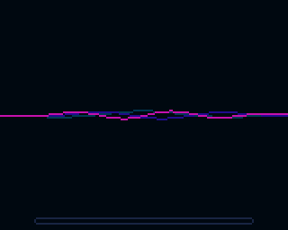

</div>

## Sommaire

- [Fonctionnalités](#-fonctionnalités)
- [Aperçu de l'écran](#-aperçu-de-lécran)
- [Matériel](#-matériel)
- [Câblage](#-câblage)
- [Installation](#-installation)
- [Utilisation](#-utilisation)
- [Effets](#-effets)
- [Documentation](#-documentation)
- [Architecture](#-architecture)
- [Ajouter un effet](#-ajouter-un-effet)
- [Dépannage](#-dépannage)

## ✨ Fonctionnalités

| | |
|---|---|
| 🎧 **Bluetooth A2DP** | Réception stéréo 44,1 kHz, métadonnées AVRCP (titre, artiste), lecture / pause / piste suivante |
| 🎚️ **15 effets + Master** | Filtres, EQ, dynamique, distorsion, modulation, delay, reverb, chaînables dans n'importe quel ordre |
| 📊 **Analyseur de spectre** | FFT 1024 points, fenêtre de Hann, 40 bandes logarithmiques, plusieurs styles d'affichage |
| 🌈 **Interface animée** | Carrousel, transitions, boutons rotatifs animés, visualisation propre à chaque effet, ~33 fps |
| 🔇 **Sans clic** | Fondu de 30 ms à l'activation / désactivation, lissage des paramètres |
| ⚡ **Temps réel** | Traitement flottant par blocs de 128 trames, ~9 % de CPU, tampon anti-gigue de 32 Ko |

## 📸 Aperçu de l'écran

| Démarrage | Spectre (courbe) | Spectre (barres) |
|:---:|:---:|:---:|
| 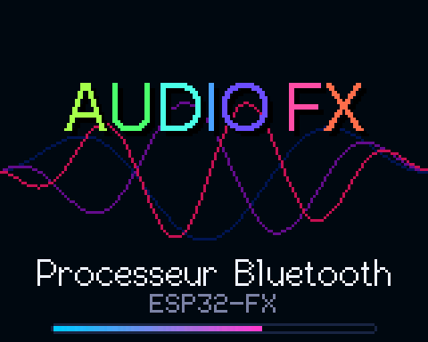 | 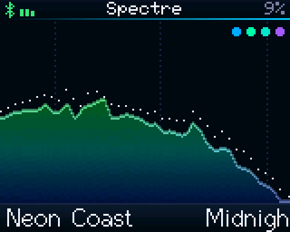 | 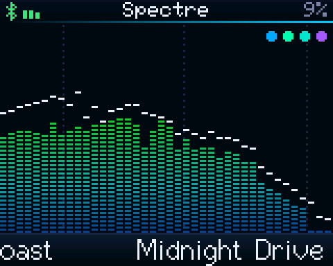 |
| **Spectre (cascade)** | **Menu carrousel** | **Liste des effets** |
| 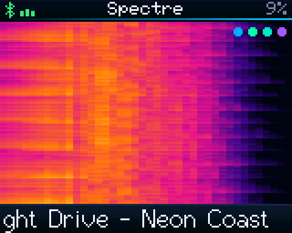 | 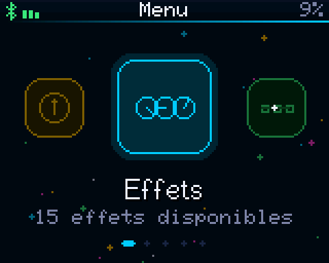 | 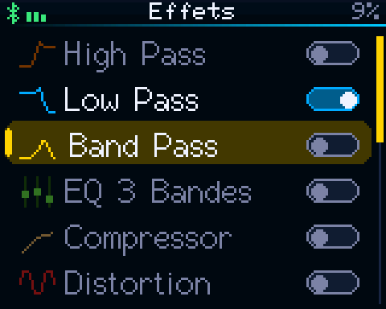 |
| **Chaîne d'effets** | **Informations système** | **Volume (potentiomètre 1)** |
| 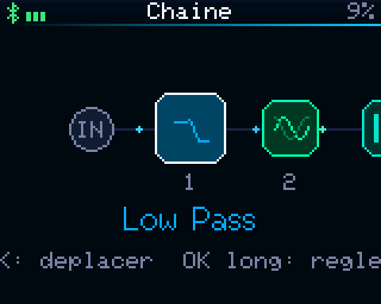 | 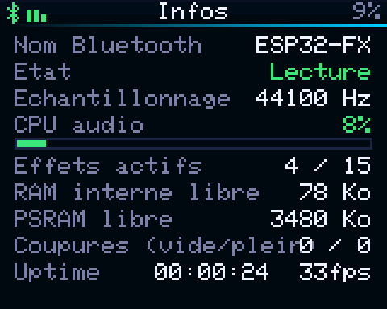 | 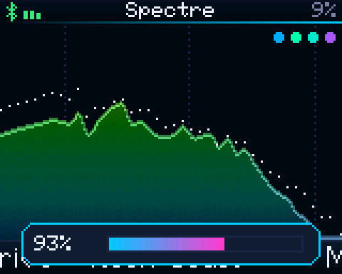 |

## 🧰 Matériel

| Composant | Quantité | Rôle |
|---|:---:|---|
| Freenove ESP32-WROVER-E (4 Mo PSRAM) | 1 | Bluetooth, traitement, interface |
| DAC PCM5102 (I2S) | 1 | Sortie audio ligne / casque |
| Écran TFT ST7735 1,8" 160×128 (SPI) | 1 | Affichage |
| Potentiomètres 10 kΩ | 4 | Réglage des paramètres |
| Boutons poussoirs | 4 | Navigation |

## 🔌 Câblage

<div align="center">

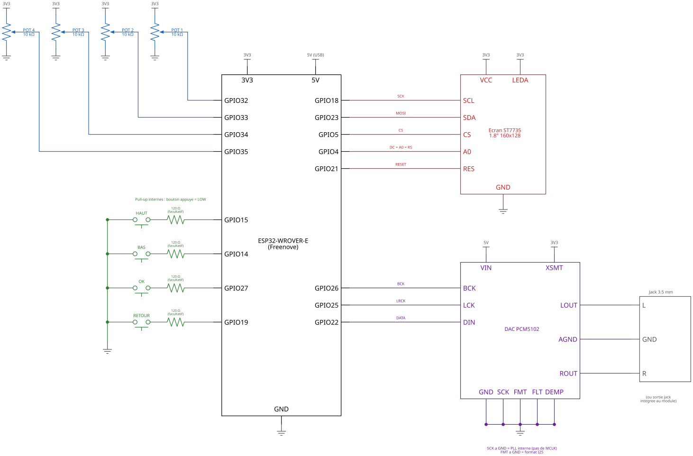

</div>

<details open>
<summary><b>Tableau des connexions</b></summary>

| Élément | Broche module | GPIO ESP32 |
|---|---|---|
| **PCM5102** | BCK | 26 |
| | LCK (LRCK) | 25 |
| | DIN | 22 |
| | SCK | GND (PLL interne) |
| | FMT, FLT, DEMP | GND |
| | XSMT | 3V3 (sortie active) |
| | VIN / GND | 5V ou 3V3 / GND |
| **ST7735** | SCL / SCK | 18 |
| | SDA / MOSI | 23 |
| | CS | 5 |
| | A0 (ou DC, ou RS selon le module) | 4 |
| | RES / RST | 21 |
| | LEDA (ou BL / LED) | 3V3 |
| | VCC / GND | 3V3 / GND |
| **Potentiomètres 10 kΩ** | curseur pot 1..4 | 32, 33, 34, 35 |
| | extrémités | 3V3 et GND |
| **Boutons** (vers GND) | HAUT / BAS / OK / RETOUR | 15 / 14 / 27 / 19 |

</details>

> [!NOTE]
> - Les potentiomètres sont sur l'**ADC1** : l'ADC2 est inutilisable quand la radio Bluetooth tourne.
> - Les boutons utilisent les pull-up internes. Ils se branchent directement entre leur GPIO et GND, sur deux pattes **en diagonale** du bouton.
> - **Rétroéclairage** : LEDA (anode des LED) se branche directement sur le 3V3, sans résistance. Si le module a une broche LEDK, elle va à GND.

> [!WARNING]
> - **Ne maintenez pas HAUT (GPIO 15) au démarrage** : c'est une broche de configuration du boot.
> - **N'utilisez pas** les GPIO 16/17 (PSRAM du WROVER), 6 à 11 (flash) ni 12 (broche de démarrage).

## 🚀 Installation

**Prérequis** : [VS Code](https://code.visualstudio.com) avec l'extension [PlatformIO IDE](https://platformio.org/install/ide?install=vscode), ou PlatformIO Core en ligne de commande. Les librairies ([ESP32-A2DP](https://github.com/pschatzmann/ESP32-A2DP) 1.8.7 et [TFT_eSPI](https://github.com/Bodmer/TFT_eSPI) 2.5.43) sont téléchargées automatiquement.

```bash
# Compiler et flasher
pio run -t upload

# Moniteur série (115200 bauds)
pio device monitor
```

Dans VS Code : ouvrez le dossier, puis cliquez sur **→ Upload** dans la barre PlatformIO.

Au démarrage, l'appareil apparaît en Bluetooth sous le nom **ESP32-FX**. Appairez-le depuis le téléphone puis lancez la musique.

## 🎮 Utilisation

| Écran | HAUT / BAS | OK | OK long | RETOUR | RETOUR long |
|---|---|---|---|---|---|
| Spectre (accueil) | piste suivante / précédente | menu | style du spectre | lecture / pause | bypass général |
| Menu (carrousel) | naviguer | ouvrir | | retour | |
| Liste des effets | naviguer | régler l'effet | ON / OFF | retour | |
| Page d'un effet | effet précédent / suivant | ON / OFF | valeurs par défaut | retour | |
| Chaîne | sélectionner / déplacer | saisir / poser | régler l'effet | retour | |

- Sur la page d'un effet, les **4 potentiomètres** pilotent les 4 paramètres. Un potentiomètre ne prend la main qu'une fois qu'on le tourne : le point orange montre sa position physique en attendant.
- Sur les autres écrans, le **potentiomètre 1 règle le volume général**.
- Maintenez **RETOUR** au démarrage pour ouvrir l'écran **Test boutons**.

## 🎛️ Effets

| Catégorie | Effet | Paramètres (pots 1 → 4) |
|---|---|---|
| **Filtres** | Low Pass | Cutoff · Résonance · Pente 12/24 dB · LFO auto-wah |
| | High Pass | Cutoff · Résonance · Pente 12/24 dB · LFO auto-wah |
| | Band Pass | Cutoff · Résonance · Pente 12/24 dB · LFO auto-wah |
| | EQ 3 bandes | Grave · Médium · Fréquence médium · Aigu |
| **Dynamique** | Compressor | Seuil · Ratio · Attaque · Relâche |
| | Distortion | Drive · Tone · Type (4 courbes) · Mix |
| | Bitcrusher | Bits · Réduction d'échantillonnage · Mix |
| **Modulation** | Ring Mod | Fréquence · Forme · Mix |
| | Tremolo | Vitesse · Profondeur · Forme · Déphasage stéréo |
| | AutoPan | Vitesse · Profondeur · Forme |
| | Phaser | Vitesse · Profondeur · Feedback · Étages 4/6/8/12 |
| | Flanger | Vitesse · Profondeur · Feedback ± · Mix |
| | Chorus | Vitesse · Profondeur · Largeur · Mix |
| **Temporels** | Delay | Temps · Feedback · Mix · Stéréo / Ping-pong |
| | Reverb (Freeverb) | Taille · Amorti · Largeur · Mix |
| **Sortie** | Master *(toujours actif)* | Volume · Balance · Largeur stéréo · Limiteur |

<details open>
<summary><b>Pages des effets</b> : chaque effet a sa visualisation et ses 4 boutons rotatifs</summary>

| **High Pass** | **Low Pass** | **Band Pass** | **EQ 3 bandes** |
|:---:|:---:|:---:|:---:|
| 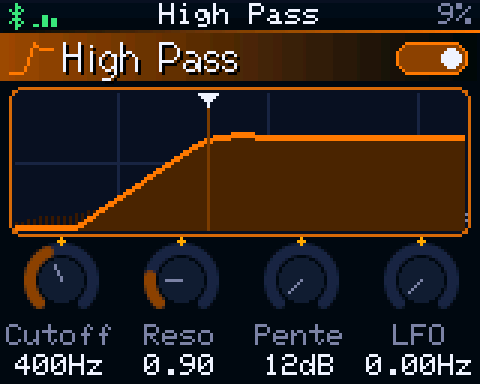 | 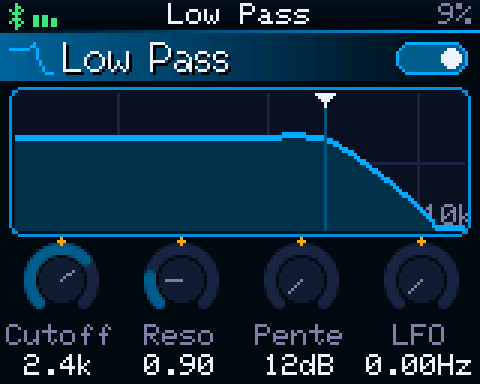 | 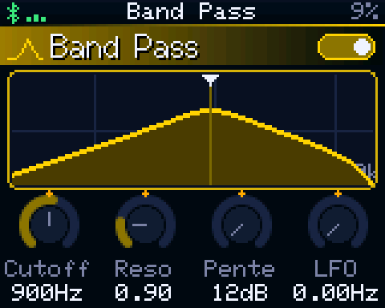 | 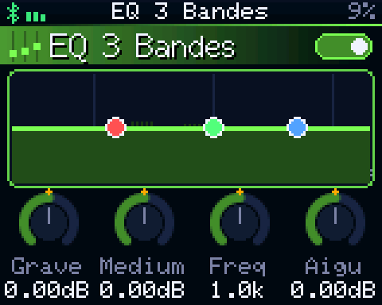 |
| **Compressor** | **Distortion** | **Bitcrusher** | **Ring Mod** |
| 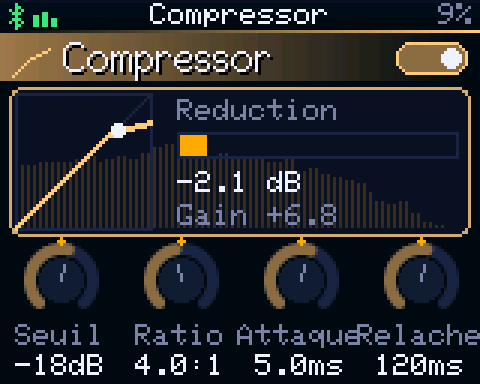 | 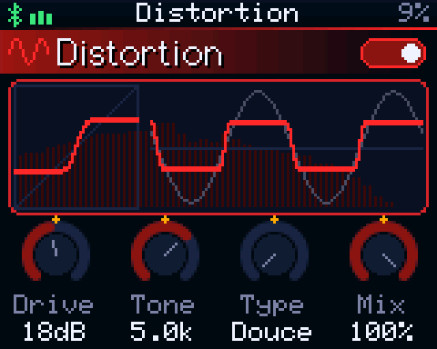 | 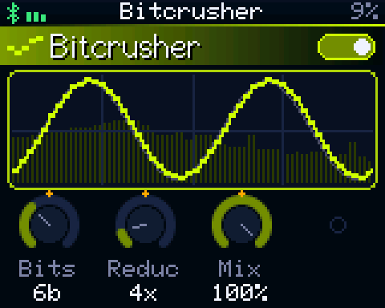 | 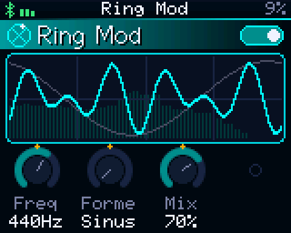 |
| **Tremolo** | **AutoPan** | **Phaser** | **Flanger** |
| 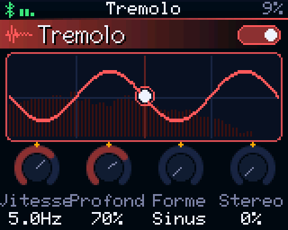 | 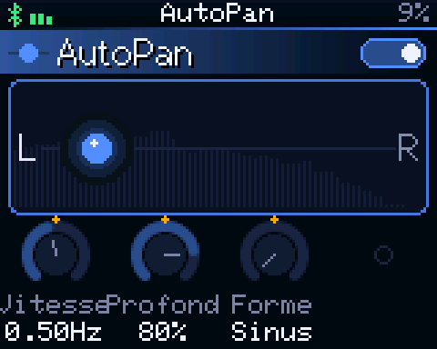 | 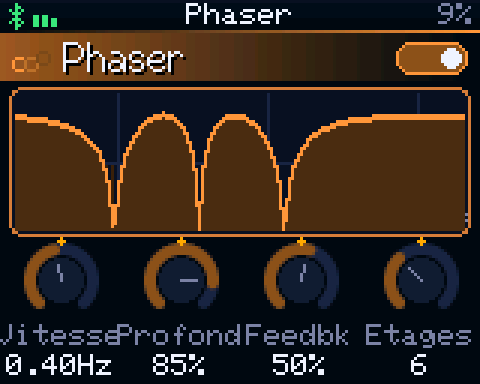 | 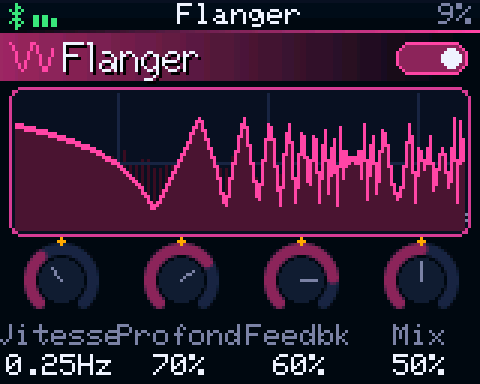 |
| **Chorus** | **Delay** | **Reverb** | **Master** |
| 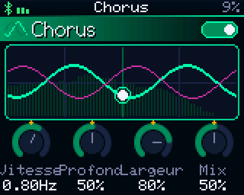 | 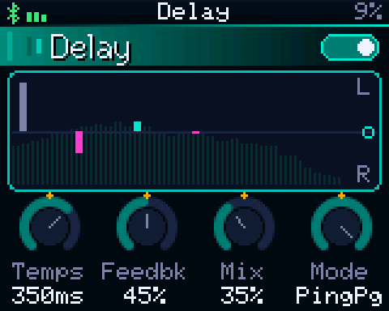 | 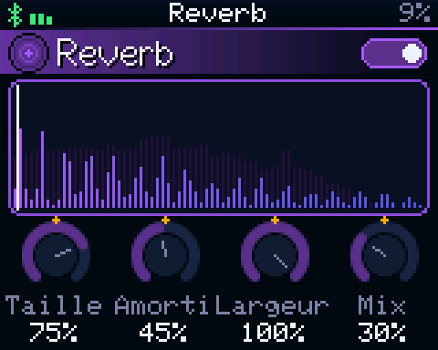 | 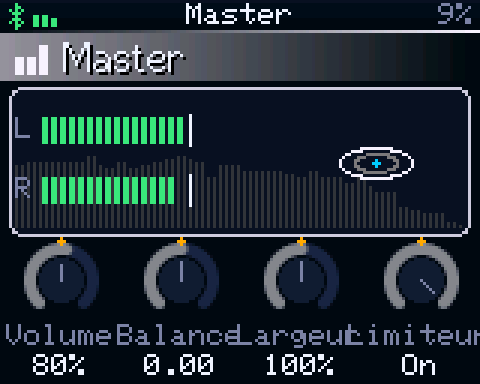 |

</details>

## 📘 Documentation

Le fonctionnement de chaque effet est détaillé dans **[ESP32_Audio_FX_effets.pdf](docs/latex/ESP32_Audio_FX_effets.pdf)** : principe, équations, schémas-blocs, paramètres, extraits de code et mesures. Toutes les courbes sont obtenues en exécutant le vrai code des effets.

## 🏗️ Architecture

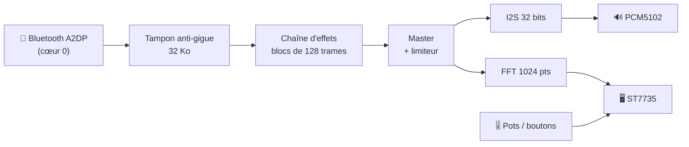

```
src/
├── main.cpp                démarrage des tâches
├── audio/
│   ├── AudioEngine         tampon anti-gigue, chaîne d'effets, I2S 32 bits (cœur 1)
│   └── Bluetooth           A2DP + AVRCP (métadonnées, lecture/pause/piste)
├── dsp/                    Biquad, lignes à retard, LFO, FFT
├── effects/
│   ├── Effect.h            CLASSE PARENT : paramètres + traitement + affichage
│   ├── FilterEffect.h      classe intermédiaire des filtres (LPF / HPF / BPF)
│   ├── <Nom>Effect.h       un fichier par effet (classes enfants)
│   └── AllEffects.h        inclut tous les effets
└── ui/                     écrans, transitions, spectre, entrées
include/Config.h            broches et constantes globales
```

## 🧩 Ajouter un effet

```cpp
class MonEffet : public Effect {
 public:
  MonEffet() : Effect("Mon effet", gfx::rgb(255, 0, 128)) {
    addParam("Gain", "dB", -12.f, 12.f, 0.f);       // pot 1
    addParam("Mix", "%", 0.f, 1.f, 0.5f);            // pot 2
  }
  // facultatif : visualisation propre à l'effet (sinon onde animée par défaut)
  void drawVisual(Canvas& g, int x, int y, int w, int h, const PageCtx& ctx) const override { ... }
  void drawIcon(Canvas& g, int cx, int cy, uint16_t col, float t) const override { ... }
 protected:
  void process(float* L, float* R, int n) override { ... }  // tâche audio
  void onParamsChanged() override { ... }                    // recalcul des coefficients
};
```

1. Créez `src/effects/MonEffet.h`.
2. Incluez-le dans `AllEffects.h`.
3. Ajoutez-le à la liste dans `AudioEngine::begin()`.

La classe parent gère le reste : fondu ON/OFF sans clic, mappage des potentiomètres (linéaire, log, entier, choix), formatage des valeurs et page complète avec ses boutons rotatifs animés.

## 🛠️ Dépannage

| Symptôme | Solution |
|---|---|
| Écran totalement noir | Vérifiez le rétroéclairage : LEDA doit être reliée au 3V3 |
| Couleurs fausses ou bord parasite | Dans `platformio.ini`, remplacez `ST7735_BLACKTAB` par `ST7735_GREENTAB`, `ST7735_GREENTAB2` ou `ST7735_REDTAB` |
| Rouge et bleu inversés | Ajoutez `-DTFT_RGB_ORDER=TFT_BGR` dans `platformio.ini` |
| Un bouton ne répond pas | Branchez-le sur deux pattes en diagonale, puis vérifiez avec l'écran **Test boutons** (RETOUR maintenu au démarrage) |
| Appareil invisible sur le téléphone | Relancez une recherche Bluetooth, ou oubliez l'ancien appairage |
| `pio: command not found` | Utilisez le terminal PlatformIO de VS Code, ou ajoutez `~/.platformio/penv/bin` au `PATH` |
